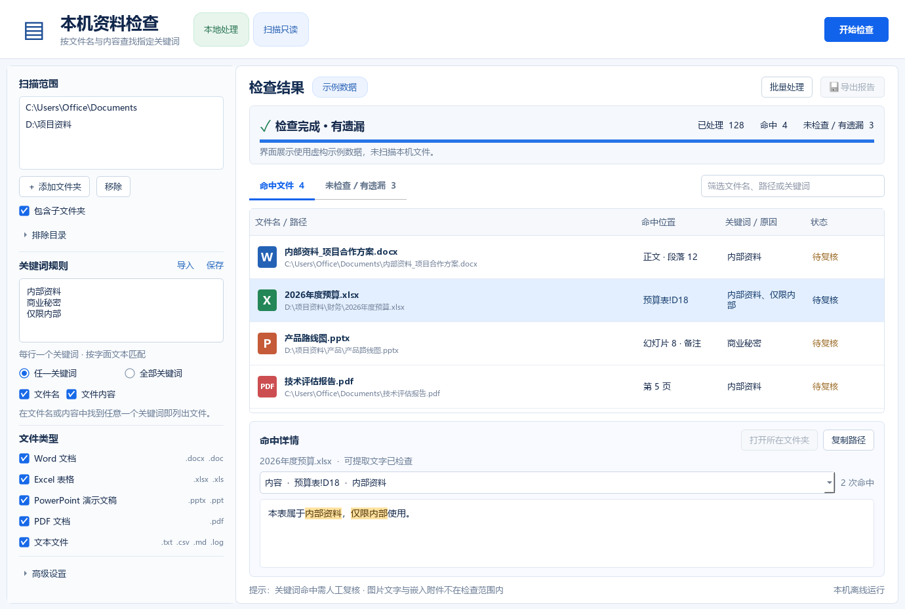
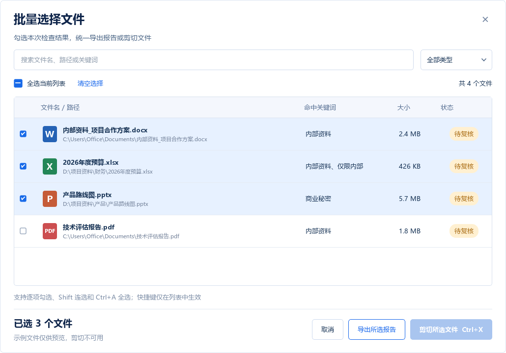

# 敏感资料检查工具

在 Windows 办公电脑上按关键词检查文件名和文件文字内容，供合规自查和人工复核。使用 Python + PySide6，提供无需安装 Python 的独立 EXE。

[下载 Windows EXE](https://github.com/TANGuoGUO/sensitive-file-checker/releases/latest) · [全部版本](https://github.com/TANGuoGUO/sensitive-file-checker/releases)



## 功能

- 多文件夹扫描、包含子文件夹、排除目录、文件类型和文件大小筛选。
- 文件名与内容可独立检查；支持任一 / 全部关键词、大小写选项、规则导入与保存。
- Word 段落、Excel 单元格、PPT 幻灯片及备注、PDF 页码等命中定位和原文高亮。
- 后台检查、暂停、继续、停止；读取失败与内容覆盖不完整的文件单独展示。
- CSV 和 JSON 报告，包含检查范围、规则、结果、任务状态和异常记录。
- 批量选择弹窗：搜索、类型筛选、逐项勾选、Shift 连选和当前列表全选；导出所选报告或将文件剪切到 Windows 剪贴板。
- 本地只读检查，不上传文件或内容；启动时不会自动扫描任何目录。

## 使用

从 Releases 下载 `SensitiveFileChecker.exe` 后双击运行，无需安装 Python。也可下载便携版 ZIP，将整个文件夹解压后运行其中的 EXE；便携版的 `_internal` 目录必须与 EXE 一起保留，不能只复制 EXE。添加检查目录，输入关键词，选择文件名 / 内容、任一 / 全部关键词、文件类型和其他范围设置，然后开始检查。检查过程中可以暂停、继续或停止；停止后的结果只包含已处理文件，不代表整个目录检查完成。

关键词按字面文本匹配，每行一个。当同时选择文件名与内容时，两个位置的命中会合并：“全部关键词”要求每个关键词在同一文件的文件名或可提取内容中至少出现一次。可导入仓库中的 `sample-rules.json` 作为规则示例。

默认检查常见 Office 文件、PDF 和文本文件，实际类型可在界面中选择。文件解析失败、超出大小限制、权限不足和目录访问异常会明确记录。命中表示发现了关键词，须人工核对文件及上下文，不能直接据此认定违规。

检查结束后点击结果区的 **批量处理**，在弹窗中勾选文件。搜索和类型筛选会保留已选项；底部显示总选择数及隐藏的选择数。“全选当前列表”与列表内的 `Ctrl+A` 只选择当前筛选可见的文件，“清空选择”清除全部选择。命中文件页与异常文件页分别保留选择，新检查会清空上次选择。

点击 **导出所选报告**，在保存窗口选择 CSV 或 JSON。点击 **剪切所选文件**（列表聚焦时也可按 `Ctrl+X`），然后到 Windows 文件资源管理器中的目标文件夹按 `Ctrl+V`。工具只写入文件剪贴板，粘贴时由 Windows 移动文件。只要所选项中有不存在或无法访问的文件，就会停止本次剪切并提示；目录异常记录不进入文件选择。示例模式不能剪切文件。



## 报告

- **JSON**：完整任务报告，包含检查范围、规则、任务状态和统计、所有已处理文件及异常，适合留档。
- **CSV**：适合用 Excel 筛选的结果清单，使用 UTF-8 BOM，支持中文、路径和换行。`记录类型` 中 `FILE` 为文件结果，`TASK` 为任务摘要与范围规则，`WARNING` 为任务异常。即使没有文件结果，也会保留任务摘要，避免将未完成检查误认为无风险。
- 命中明细可能按预览数量上限截断，报告会标明。报告会包含路径、关键词和命中片段，本身也应按敏感资料妥善保存。
- 所选报告只导出勾选的文件结果，并保留原任务统计和异常。JSON 的 `export_scope` 与 CSV 的 `TASK` 行详细数据注明所选数量及当前结果页的总数量；原任务的命中数不会改成所选数量。

## 开发运行与打包

当前发布版本适用于 **Windows 10 1809（build 17763）及以上的 64 位系统或 Windows 11 x64**；不适用于 Windows 7 / 8 或 32 位 Windows。此要求来自 [Qt 6.10 官方支持平台](https://doc.qt.io/qt-6.10/supported-platforms.html)。开发运行还需要 Python 3.9 或更高版本：

```powershell
git clone https://github.com/TANGuoGUO/sensitive-file-checker.git
cd sensitive-file-checker
python -m venv .venv
.\.venv\Scripts\Activate.ps1
python -m pip install -r requirements.txt
python launcher.py
```

构建独立 EXE：

```powershell
powershell -ExecutionPolicy Bypass -File .\build.ps1
```

可用 `-PythonPath C:\路径\python.exe` 指定 Python，`-Layout onefile` 或 `-Layout portable` 单独构建一种布局，默认两者都构建。建议在独立虚拟环境中安装依赖后打包。脚本自动寻找可用 Python、检查依赖，失败即停止；不会自动联网安装依赖。单文件产物为 `dist\SensitiveFileChecker.exe`；便携版为 `dist\SensitiveFileChecker-portable\`。首次启动单文件版需等待临时解包。

运行测试：

```powershell
python -m pip install -r requirements-dev.txt
python -m pytest tests -q
```

`--demo` 只展示虚构界面数据；正常启动不会自动扫描任何目录。`--batch-screenshot 界面.png` 可保存示例批量弹窗截图。`--smoke-test 检查结果.json` 使用自动创建的人工文本、PDF 和加密 PDF 验证扫描、批量选择、所选报告与剪贴板数据格式，不读取用户办公文件，也不改系统剪贴板。

独立验证打包后的程序：

```powershell
.\dist\SensitiveFileChecker.exe --smoke-test smoke-result.json
```

当前验证：92 项自动测试通过；真实 Windows 平台 Qt 启动探测，以及人工文本/PDF 命中、加密 PDF 异常处理、批量选择与所选导出自检通过。剪切测试使用模拟剪贴板，验证文件 URL 与 Windows MOVE 标记，未实际粘贴移动文件。旧版 Office 自动化分支已用模拟测试验证，尚未进行真实 Microsoft Office 读取实测。

## 启动失败排查

出现 `Could not load PyInstaller's embedded PKG archive`，表示启动器无法读取 EXE 内的程序归档，尚未进入 Python / Qt，不等同于缺少运行库。

1. 从 Releases 重新下载完整 ZIP，解压到普通本地目录。保留便携版的整个目录结构。
2. 双击包中的 `diagnose.cmd`。不需要安装 Python；会在 `diagnostic-...` 文件夹保存系统版本、EXE 哈希、启动错误和诊断结果，不扫描办公文件，不安装组件，不联网或上传日志。
3. 将文件 SHA-256 与同一版本的 `SHA256SUMS.txt` 比较。不同表示文件与发行版不一致，应检查下载或传输完整性；相同仍报错，则需结合启动日志、文件访问权限和企业安全软件的事件记录定位，不能单凭报错认定文件损坏。

手动校验示例（文件改名不改变 SHA-256）：

```powershell
Get-FileHash .\SensitiveFileChecker.exe -Algorithm SHA256
```

也可以直接运行启动诊断：

```powershell
.\SensitiveFileChecker.exe --diagnostics --output .\diagnostic-output
```

若启动器本身已经因归档损坏或访问受限而退出，程序内的诊断参数也无法执行；这时使用外部 `diagnose.cmd`，它仍能记录文件校验和启动错误。日志仅保存在本机，确认后可将报告交给维护者分析。

## 检查边界

- 检查只读取所选文件，结果保存在本机，不上传文件或检查内容。
- DOCX / XLSX / PPTX 等现代 Office 格式直接解析；旧版 DOC / XLS / PPT 需要 Windows 上安装对应 Microsoft Office 组件，并启用旧格式兼容读取（默认关闭）。旧格式解析通过 Office 自动化完成，可能受到 Office 安装、首次启动对话框或文件保护状态影响。
- 扫描版 PDF 和图片不做 OCR；检测到图片、嵌入对象等未展开内容时，会显示“有遗漏”并记录原因。图片文字、嵌入对象内部内容、音视频、压缩包内部文件不属于内容检查范围。
- 加密、损坏、受权限限制或超过限制的文件可能无法完整检查，请查看异常与内容检查状态。未命中不能证明机器上不存在内部资料。

## 项目结构

| 文件 | 用途 |
| --- | --- |
| `app.py` | PySide6 界面、后台任务与交互 |
| `batch_dialog.py`、`file_clipboard.py` | 批量选择弹窗与 Windows 文件剪贴板 |
| `launcher.py`、`diagnostics.py` | GUI 导入前的启动层与系统/Qt 诊断 |
| `scanner.py` | 目录遍历、关键词匹配、暂停停止与统计 |
| `extractors.py` | Office / PDF / 文本读取与覆盖状态 |
| `reports.py` | JSON / CSV 报告导出 |
| `tests/` | 人工文件与模拟场景测试 |
| `build.ps1`、`SensitiveFileChecker.spec` | Windows 单文件 EXE / 便携文件夹构建 |
| `diagnose.cmd`、`diagnose.ps1` | 无需 Python 的外部启动与文件校验诊断 |

`assets/ui-concept.png` 为生图设计稿，`assets/implemented-exe-ui.png` 为实际程序界面（虚构示例数据）。设计使用内置 imagegen，提示词保存在 `assets/ui-design-prompt.txt`。依赖通过 `requirements.txt` 安装，构建缓存、临时检查报告和依赖安装目录不纳入仓库。
